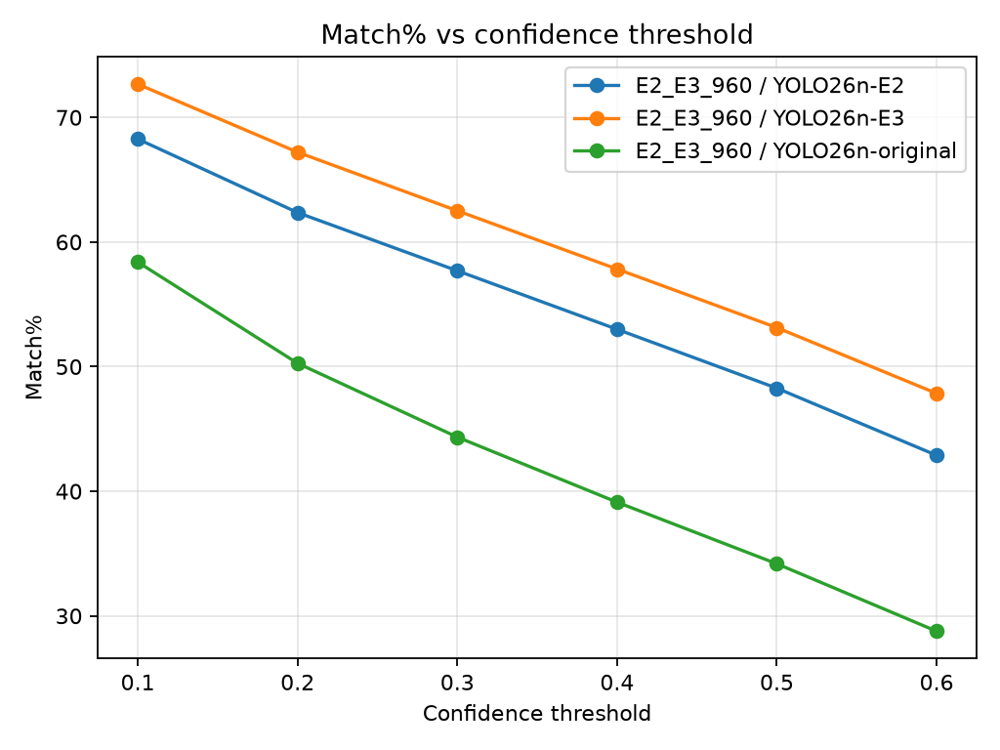
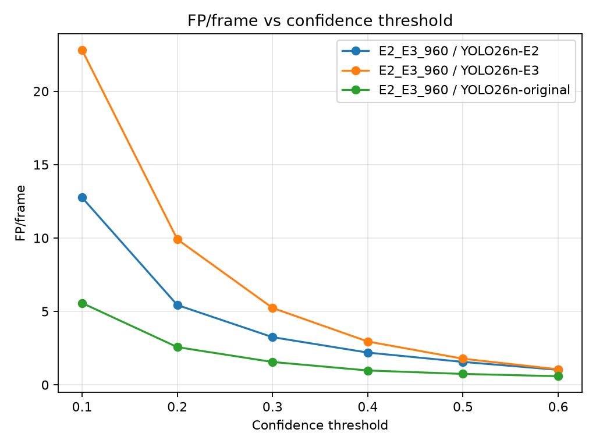
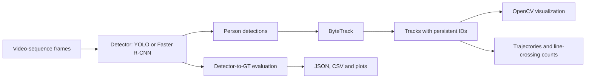

# Real-Time Multi-Object Tracking

An engineering portfolio project for pedestrian detection and multi-object tracking on video sequences. It combines interchangeable detectors, ByteTrack identity association, trajectory and line-crossing visualization, MOT17 evaluation, and controlled YOLO26n fine-tuning experiments.

The project separates **detection quality** from **tracking quality**: its current quantitative benchmark evaluates detector boxes against ground truth; the tracking demos visualize identities but do not yet report standard MOT tracking metrics.

**Stack:** Python · PyTorch · Ultralytics YOLO26 · Torchvision Faster R-CNN · OpenCV · ByteTrack · MOT17

## What is implemented

- A shared detector interface with YOLO and Torchvision Faster R-CNN implementations, both returning person detections in a common format.
- ByteTrack integration for persistent track IDs, plus bounding-box trajectory visualization and directional line-crossing counts.
- MOT17 detector evaluation with confidence sweeps, IoU matching, localization and coverage metrics, resumable checkpoints, stable JSON results, and plots.
- Supervised YOLO26n fine-tuning and an experimental teacher pseudo-labeling mode. Runs record configuration, weight hashes, training history, and output paths in experiment manifests.
- Dataset auditing and preparation for a sequence-level MOT17 train/validation split.

The interactive examples process MOT17 frame directories and display results with OpenCV. They do not currently accept arbitrary video files or save annotated output videos. ByteTrack is the only tracker integrated; BoT-SORT and TrackEval are not implemented.

## Results: controlled YOLO26n fine-tuning

Five experiments started independently from the same pretrained `yolo26n.pt` checkpoint; no experiment was initialized from another experiment's weights. The completed runs used the same MOT17 sequence split, AdamW, batch size 16, seed 0, and early stopping. E4 froze the first 11 indexed YOLO26n layers (the declared backbone); the neck and detection head remained trainable.

| Experiment | Training setup | Change under study |
| --- | --- | --- |
| E0 | LR 0.001, 640 | Initial supervised baseline |
| E1 | LR 0.0001, 640 | Lower learning rate |
| E2 | LR 0.0001, 960 | Higher training resolution |
| E3 | LR 0.0001, 960, multi-scale 0.25 | Multi-scale training |
| E4 | LR 0.0001, 960, freeze 11 | Frozen backbone |

The table reports the saved validation sweeps at **960-pixel inference size**, confidence **0.30**, and matching IoU **0.50**. E2/E3 and E2/E4 were recorded in separate evaluation JSONs but use the same held-out sequences and evaluation settings.

| Model | Matched GT pedestrians | Mean IoU | Mean edge error | Unmatched predictions / frame |
| --- | ---: | ---: | ---: | ---: |
| Original YOLO26n | 44.35% | 0.838 | 4.49% | 1.55 |
| E2 | 57.69% | 0.806 | 5.79% | 3.25 |
| E3 | **62.51%** | 0.801 | 5.94% | 5.24 |
| E4 | 56.22% | 0.813 | 5.50% | 2.94 |

“Matched GT” is the share of marked pedestrian ground-truth boxes matched at IoU ≥ 0.50. Edge error is normalized by ground-truth box dimensions. Higher coverage comes with more unmatched predictions for E3 at this threshold. E4 gives up some E2 coverage while improving its mean localization measures and reducing unmatched predictions.

The original detector has the strongest localization averages among its matched boxes, but covers fewer pedestrians. In the training manifests, the best Ultralytics validation mAP50–95 at 640 rose from 0.362 for E0 to 0.378 for E1 after lowering the learning rate. At 960, E2, E3, and E4 recorded 0.472, 0.468, and 0.463 respectively. These are Ultralytics checkpoint-selection metrics, not the custom matching results in the table; 640 and 960 runs also use different validation input sizes. The experiments suggest useful trade-offs in this split, not general rules about YOLO26.

The confidence threshold changes that trade-off. At roughly the same unmatched prediction rate, E3 at confidence 0.40 matches 57.83% of GT at 2.95 unmatched predictions/frame; E4 at 0.30 matches 56.22% at 2.94/frame. There is no single candidate that leads on every measure. Localization averages are calculated only over matched pairs, so different models can be measured on different subsets of pedestrians.

The evaluator calls every unmatched prediction a false positive, including predictions over distractors or ignored MOT annotations. These counts therefore describe this project's matching policy, not official MOTChallenge false-positive scores.

### Confidence-threshold curves

The curves below are generated from the saved E2/E3 validation JSON at 960. They show why model and confidence selection should be considered together.





## Pipeline



Detection and tracking are separate modules: detector adapters produce common `Detection` objects; `ByteTracker` converts them to the Ultralytics ByteTrack API; visualization and analytics consume `Track` objects. The evaluator measures detector boxes independently of the tracker.

## Installation

Python 3.10 or newer is required by the source syntax. From the repository root, create an environment and install the project's runtime and analysis dependencies:

```bash
python -m venv .venv
source .venv/bin/activate
python -m pip install --upgrade pip
python -m pip install -r requirements-training.txt -r requirements-analysis.txt
```

On Windows PowerShell, activate with `.venv\Scripts\Activate.ps1`. The training requirements install Ultralytics and its PyTorch dependencies; the analysis requirements install Matplotlib. For CUDA, install a PyTorch/Torchvision build compatible with the machine's driver before running GPU workloads. CPU execution is available, though full evaluation and training can take substantially longer.

The repository does not pin an exact Python, PyTorch, CUDA, or Ultralytics build. Experiment manifests record the installed Ultralytics version and run configuration. Add test tooling separately when needed:

```bash
python -m pip install -r requirements-test.txt
python -m pytest
```

## Dataset and quick start

Download the MOT17 **training** data from [MOTChallenge](https://motchallenge.net/data/MOT17/) and unpack it so each sequence is under `datasets/MOT17/train/`, for example `datasets/MOT17/train/MOT17-04-FRCNN/{img1,gt,seqinfo.ini}`. Dataset images and annotations are not included in this repository. The examples use training and held-out validation sequences only; they do not use the official test split.

Run a small detector-evaluation smoke check on up to eight frames per validation sequence:

```bash
python -m src.evaluation.evaluate_detectors \
  --split-config configs/mot17_training_split.json \
  --partition validation \
  --max-frames 8 \
  --model YOLO26n=yolo26n.pt \
  --skip-estimate
```

Ultralytics can download standard YOLO weights when first requested; alternatively, place the selected checkpoint at the path passed to `--model`. The smoke check is only for verifying setup. Remove `--max-frames 8` for a full validation sweep. By default, the evaluator sweeps confidence thresholds from 0.10 through 0.60, matches at IoU 0.50, and writes a JSON under `results/evaluation/`.

To audit the configured split and prepare YOLO-format data for training:

```bash
python -m src.training.inspect_dataset --split-config configs/mot17_training_split.json
python -m src.training.train_detector --mode supervised --split-config configs/mot17_training_split.json --prepare-only
```

The split is defined in [`configs/mot17_training_split.json`](configs/mot17_training_split.json):

| Partition | MOT17 FRCNN sequences |
| --- | --- |
| Train | 02, 05, 09, 10, 13 |
| Validation | 04, 11 |

It separates complete scenes rather than adjacent frames, which reduces temporal leakage between train and validation. Preparation retains readable frames and labels only marked class-1 pedestrians as the single `person` class. The current training loss has no explicit ignore-region mask; unlabeled ambiguous objects can be treated as background.

## Tracking demonstration

The scripts under [`scripts/`](scripts/) are small interactive MOT17 examples. [`run_tracking.py`](scripts/run_tracking.py) runs YOLO detection followed by ByteTrack and displays bounding boxes with track IDs. [`run_trajectories.py`](scripts/run_trajectories.py) adds recent track paths; [`run_line_crossing.py`](scripts/run_line_crossing.py) adds a normalized counting line and directional counts.

These scripts currently set the sequence, model weights, and confidence threshold as constants near the top of each file; they do not expose CLI flags. After installing dependencies, obtaining MOT17, and making the configured weights available, run from the repository root:

```bash
python scripts/run_tracking.py
```

Press `q` in the display window to close it. A tracking video or screenshot is not committed, so the README does not use a static training image as a tracking demo.

## Evaluation and reproducibility

The saved results are detector comparisons, not tracker benchmarks. The evaluator runs each frame once per model, then applies the requested confidence thresholds to those detections. It stores aggregate and per-sequence results, evaluation settings, model weight signatures and hashes; longer runs also use resumable checkpoint JSON and logs.

Run a full validation comparison on the configured split:

```bash
python -m src.evaluation.evaluate_detectors \
  --split-config configs/mot17_training_split.json \
  --partition validation \
  --model Original=yolo26n.pt \
  --model E2=results/training/<E2-run>/weights/best.pt \
  --model E4=results/training/<E4-run>/weights/best.pt \
  --imgsz 960 \
  --evaluation-name yolo26n_E2_E4_validation_960 \
  --skip-estimate
```

Replace the run placeholders with completed experiment paths. Omit `--imgsz 960` for stride-aligned native-resolution inference. The command-line options can be checked with `python -m src.evaluation.evaluate_detectors --help`.

Generate plots from saved evaluation JSONs (no model inference is run):

```bash
python -m src.analysis.plot_evaluation \
  --evaluation results/evaluation/E2_E3_960.json \
  --output-dir results/plots/yolo26n-E2-E3-validation-960
```

Training runs save an `experiment.json` manifest and Ultralytics CSV history under `results/training/<experiment-id>/`. The plotting utility can read an existing manifest with `--training-manifest` or compare histories with repeated `--training-csv LABEL=PATH` arguments. To reproduce the documented experiments, see [`docs/yolo26n-supervised-experiments.md`](docs/yolo26n-supervised-experiments.md); this includes the exact settings and E4 freeze verification. Training uses `yolo26n.pt` as the starting checkpoint. Model weights, MOT17 files, prepared images, and full training outputs are not versioned in Git.

Operational detector speed has a separate command, `src.evaluation.benchmark_detector_speed`. It times `detector.predict()` at a selected confidence after warmup and excludes frame decoding and matching. The confidence sweep's FPS field is not an end-to-end throughput claim.

## Project structure

```text
src/
├── analytics/      # line-crossing logic
├── analysis/       # plots from saved evaluations and training CSVs
├── detection/      # detector interface, YOLO, Faster R-CNN
├── evaluation/     # MOT17 loading, matching, metrics, benchmarks, JSON
├── tracking/       # ByteTrack adapter and trajectory history
├── training/       # split audit, dataset preparation, fine-tuning, manifests
└── visualization/  # frame overlays
configs/            # shared MOT17 split
docs/decisions/     # architecture decision records (ADRs)
scripts/            # interactive MOT17 examples
tests/              # unit and integration tests
results/             # local evaluation and plot artifacts
```

Technical choices are recorded in [Architecture Decision Records](docs/decisions/README.md), including the detector abstraction ([ADR-002](docs/decisions/002-separate-detection-from-tracking.md)), ByteTrack ([ADR-003](docs/decisions/003-use-bytetrack-as-first-tracker.md)), geometry-focused detector metrics ([ADR-007](docs/decisions/007-use-geometric-detection-metrics.md)), and sequence-level data split ([ADR-011](docs/decisions/011-split-training-and-validation-by-sequence.md)). Some later ADRs remain proposed; they are decisions under investigation, not claims of completed features.

## Limitations

- The held-out MOT17 validation sequences also informed model selection; no independent ground-truth test benchmark was run. Results are development validation results, not official MOT17 test scores.
- The evaluator matches marked class-1 GT only and counts all unmatched predictions, including predictions on ignored or distractor objects. Its custom metrics are not official MOTChallenge scores.
- Accuracy and throughput depend on input resolution, hardware, weights, and confidence threshold. Reported geometry means cover matched objects only.
- Detector quality does not establish identity consistency. Standard tracking metrics such as IDF1, MOTA, and HOTA have not been implemented or reported.
- E4's freeze verification confirmed frozen parameters remained unchanged, but BatchNorm running statistics in frozen layers were not frozen.

## Further work

Add an exportable tracking-video workflow and evaluate tracking identity metrics under an official MOT protocol. The current experiments also motivate more controlled studies of threshold calibration and training resolution.
